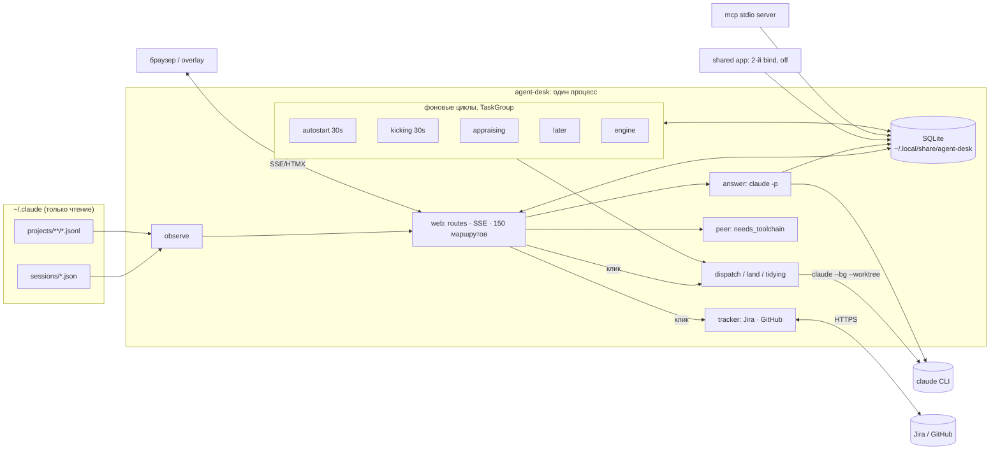

# 02 · Текущее состояние

Снимок: `origin/main` @ `974a306`. Метрики сняты командами `wc`, `git`, `pytest`, `ruff`, `mypy`,
выполненными в ходе аудита. Код проекта не менялся.

## Размер

| | Значение | Источник |
|---|---|---|
| Python, приложение | 86 файлов, 29 045 строк | `[ФАКТ: find agent_desk -name '*.py' \| xargs wc -l]` |
| Python, тесты | 146 файлов, 41 923 строк, 2701 тест | `[ФАКТ: прогон pytest]` |
| JS / CSS (самописные) | `console.js` 7262, `console.css` 3351 строк | `[ФАКТ]` |
| Шаблоны Jinja2 | 40 файлов, 3675 строк | `[ФАКТ]` |
| Миграции SQL | 78 (`002`–`078`, `066` пропущена) | `[ФАКТ: agent_desk/store/*.sql]` |
| HTTP-маршруты в `web/routes.py` | 150 | `[ФАКТ: grep @router]` |
| Документация | 12 docs, 12 ADR, 13 user stories, 2 design | `[ФАКТ: docs/, design/]` |

## Карта компонентов

Статусы: **работает** / **частично** / **заглушка** / **только задумано** / **сломано**.

| Компонент | Назначение | Статус | Качество | Источник |
|---|---|---|---|---|
| `observe/registry.py`, `model.py` | чтение `~/.claude/sessions/*.json`, проверка живости по `procStart`, статусы | работает | высокое: валидация pydantic, проверка версии CLI, предупреждение о дрейфе | `[ФАКТ: прогон на живом реестре: 13 сессий, notice о 2.1.283 > 2.1.259]` |
| `observe/transcript.py`, `reading.py` | хвост транскрипта сессии | работает | высокое, на фикстурах | `tests/fixtures/transcript.jsonl` |
| `observe/shape.py`, `folder.py`, `attach.py` | группировка проект → инстанс → сессия | работает | среднее: логика часто менялась (stories 10, 11) | `docs/stories/10,11` |
| Хуки `POST /api/signal` | push-сигналы Stop/Notification | **только задумано** | — | `[ФАКТ: описан в docs/03 §3 и docs/02, маршрута нет — grep пуст]` |
| `web/sse.py` + доска | live-обновление | работает | среднее → хорошее после фикса story 05 (184 мс CPU каждые 2 с) | `docs/stories/05`, коммит «sse: stop building a megabyte every two seconds» |
| `store/repo.py` + миграции | SQLite, 60+ таблиц | работает | **низкое по структуре**: один файл на 4951 строку; миграции без инструмента, «plain SQL at startup» | `[ФАКТ]` |
| `store/redact.py` | редактирование секретов на границе | работает | хорошее: шаблоны синхронизированы с хуком (`make check-patterns`) | `Makefile` |
| `answer/session.py` | `claude -p` stream-json, fallback на локальную модель | работает | хорошее; 5 failed из 121 блока | `[ФАКТ: БД block.state]` |
| `answer/classify.py` | вопрос / идея / инструкция | работает | не измерено: доля исправлений пишется только в лог, как метрика не хранится | README §Status |
| `ideas/` (inbox, appraise, meeting, bench…) | инбокс, черновики, оценка идей | работает | хорошее; 503 идеи в реальной базе | `[ФАКТ: БД]` |
| `ideas/meeting.py` | идеи из вставленного транскрипта встречи | частично: версия 1 из 3 из docs/10 | — | `docs/10-meeting-intake.md` |
| `peer.py` | запись в работающую сессию | **заглушка по дизайну**: возвращает `needs_toolchain` | корректная: честный отказ | `docs/09-roadmap.md` Phase 3 |
| `dispatch.py`, `land.py`, `starting.py` | запуск `claude --bg --worktree`, слияние результатов | работает, но много открытых фиксов в draft-PR (#7–#12, #18, #19, #21) | среднее: 9 PR о правильном выборе worktree и сессии | `[ФАКТ: gh pr list]` |
| `web/autostart.py`, `kicking.py`, `later.py` | фоновые циклы: очередь, «не простаивать», отложенные задачи | работает, выключено по умолчанию | среднее; `later.py` покрыт на 81 % | `[ФАКТ: 010-queued-work.sql armed_at NULL; coverage]` |
| `tidying.py` | авто-закрытие сессии (ADR 0012) | работает, за отдельным переключателем | хорошее: чистая функция | `docs/adr/0012` |
| `tracker/jira.py`, `github.py` | запись идеи в Jira; чтение блокеров и PR | работает (Jira: 259 filings) | среднее; сетевые вызовы вне coverage | `[ФАКТ: БД filing=259]` |
| `web/shared.py` | второе приложение для коллег по ссылке | работает, выключено по умолчанию | хорошее разделение; **нет TLS** | README §Status |
| `mcp/` | MCP-сервер по stdio, написан вручную | работает | среднее: свой JSON-RPC без библиотеки | `agent_desk/mcp/server.py` |
| Верстак и процессы (`process.py`, `web/engine.py`, `roles.py`, `slots.py`, `comparing.py`, `grading.py`…) | конструктор процессов, прогоны, сравнение моделей | работает частично; реальное использование близко к нулю | — | `[ФАКТ: БД run=0, run_step=0, template=1, tool=1]` |
| `seen.py` | консоль как текст для агента без браузера | работает | — | — |
| Overlay (`make overlay`) | окно поверх всех | работает (Chromium `--app`) | — | `Makefile` |
| `experiments/insurance-site` | статический сайт страховой | не относится к проекту | — | **в `main`, хотя его README требует «This must not merge to main»** |

## Архитектура

Один процесс (uvicorn + FastAPI), одна SQLite, фоновые задачи в `TaskGroup`, дочерние процессы
`claude`. Заявленная в docs/02 модель «четыре компонента, данные текут в одну сторону» сохранилась
только для ядра. Вокруг выросли пять фоновых циклов и три «двери наружу».

Сильные стороны архитектуры `[ВЫВОД, уверенность высокая]`:

- Инварианты безопасности закреплены структурно и проверяются тестами на граф импортов: `peer`
  импортируется только из `web/`, а `shared` не импортирует `observe`.
- Формат чужих файлов парсится в одном месте, с проверкой версии (ADR 0004). Проверено: на CLI
  2.1.283 выдаётся корректное предупреждение.
- `TaskGroup` вместо бесхозных `create_task`, subprocess запускается только списком, без shell (тест
  `test_nothing_is_ever_handed_to_a_shell`).

Слабые стороны:

- `web/routes.py`, `store/repo.py` и `web/blocks.py` — три «божественных» модуля, вместе 13 тыс.
  строк. Любая фича трогает их, отсюда постоянные конфликты между параллельными ветками.
- UI-логика раздвоилась между серверными шаблонами и 7 тыс. строк `console.js`, у которого нет
  JS-тестов. Есть только проверка «скрипт запускается» (коммит «gate: ask whether the console's
  script runs, not only whether it parses»).

## Стек и зависимости

| Зависимость | Версия (pyproject) | Замечание |
|---|---|---|
| Python | ^3.12 | актуально |
| FastAPI | ^0.141 | актуально `[ПРОБЕЛ: pip-audit не запускался, нужна сеть]` |
| Starlette | >=1.3.1 | закреплена явно после 8 advisories на транзитивной версии `[ФАКТ: комментарий в pyproject]` |
| uvicorn[standard] | ^0.34 | ок |
| SQLAlchemy[asyncio] + aiosqlite | ^2.0 / ^0.20 | ок; миграции без Alembic — осознанный выбор (ADR 0003) |
| pydantic / settings | ^2.10 / ^2.7 | ок |
| structlog, python-ulid, pyyaml, jinja2 | — | ок |
| htmx.min.js | вендорен (`web/static/VENDORED.md`) | README утверждает, что его нет в репозитории, а он есть `[ФАКТ]` |
| **claude CLI** | не зафиксирована | **главная рискованная зависимость**: внутренний формат, фикстуры записаны на 2.1.259, установлен 2.1.283 |
| dev: ruff ^0.9, mypy ^1.14, pytest ^9.1, pip-audit, bandit | — | ок |

Устаревших зависимостей по `pyproject` не видно `[ВЫВОД, уверенность средняя: pip-audit не запускался]`.

## Тесты, CI, инфраструктура, документация

- **Тесты:** 2701 unit-тест, 2698 проходят в снимке без `.git`. Три падения воспроизводятся только
  без git-репозитория: в настоящем worktree на `origin/main` все 51 тест из тех же файлов зелёные
  `[ФАКТ: повторный прогон в ../agent-desk-shift]`. Выходит, три теста негерметичны и зависят от
  `.git` вокруг. Покрытие 94 % по веткам и порог в `make coverage` тоже 94 %. Полный прогон идёт
  **10 мин 40 с** — слишком долго для Stop-хука «на каждом ходу» `[ФАКТ]`.
- **Линт и типы:** ruff (включая bandit-правила S и ASYNC) и mypy `--strict` зелёные `[ФАКТ]`.
- **CI:** отсутствует, нет `.github/` `[ФАКТ]`. Роль CI выполняют Stop-хуки Claude Code
  (`.claude/hooks/stop-verify.sh`). Для соло это работает, для внешних контрибьюторов нет.
- **Инфраструктура:** не нужна, всё локально. Упаковка: poetry, `version = "0.0.0"`, в PyPI не
  опубликован, лицензии нет `[ФАКТ]`.
- **Документация:** очень подробная и связная, с проверкой ссылок (`make check-links`). При этом
  частично устарела относительно кода (см. ниже), а стиль (длинные эссе на английском) тяжёл для
  нового читателя `[ВЫВОД]`.

## Хронология активности

| Период | Коммитов в `main`/`origin/main` | Что происходило |
|---|---|---|
| 09-02 | 5 | каркас, спецификация, reader реестра |
| 09-03 – 09-04 | 41 | доска, блоки, идеи, Jira (ADR 0005), запуск агентов (0006, 0007) |
| 09-05 | 52 | пик; автономный агент (0008), «не простаивать» (0009), чтение трекера (0010) |
| 09-06 – 09-08 | ~100 | верстак-конструктор (0011), процессы, прогоны |
| 09-09 | 57 | инструменты, MCP, auto-close (0012), shift |
| 09-10 | 13 | фиксы по user stories из собственных замеров (03–09) |
| 09-13 | 3 | проекты и инстансы, рисование схемы проекта |
| 09-16 | 3 | последние коммиты в `origin/main`, draft-PR #19–#21 |
| 09-17 – 09-26 | 0 | **тишина 10 дней** |

Параллельно шло использование самой консоли `[ФАКТ: БД]`: вопросы 09-03…09-10 (пик 09-05, 41 шт.),
идеи до 09-16, расходы до 09-13, последний запуск задачи 09-09.

**Где остановилось:** 20 PR (19 draft + 1 open, #7), в основном мелкие фиксы dispatch и верстака.
Локальный `main` не подтянут. В 4 worktree лежит незакоммиченная работа, включая неотслеживаемый
`docs/stories/14-a-control-that-works-wherever-it-was-drawn.md` в `../agent-desk-shift` `[ФАКТ]`.

Почти весь код написан агентами Claude Code под управлением автора: ветки вида
`worktree-beri-v-rabotu-N` и формулировки коммитов указывают на запуск агентов из самой консоли
`[ВЫВОД, уверенность высокая]`.

## Расхождения документации и кода

Истиной считается код.

| Документ говорит | Код делает | Где |
|---|---|---|
| «Nothing runs it [claude] on a timer» | `kicking.appraising` вызывает модель в цикле для непрочитанных идей | README §Status vs `web/kicking.py:280` |
| «htmx.min.js is not in the repository» | файл есть, вендорен | README vs `web/static/htmx.min.js` |
| «It is not an orchestrator. It does not start, stop, steer…» | запускает, будит, закрывает сессии | README §What it is not vs `dispatch.py`, `kicking.py`, `tidying.py` |
| «does not run agents, schedule them, assign them work» | делает всё это (за переключателями) | docs/01 vs ADR 0006–0009 |
| non-goal §8: «No git log ingestion, no CI status, no tracker» | Jira, GitHub PR, git status | docs/08 vs `tracker/`, `tidying.py` |
| «One outbound network call… No polling, no retry, no read back» | чтение Jira и GitHub, коннекторы «over the network» | docs/07 §86 vs ADR 0010, `tracker/github.py` |
| `POST /api/signal` для хуков | маршрута нет | docs/02, docs/03 §3 |
| «This must not merge to main» | `experiments/insurance-site` в `main` | experiments/insurance-site/README.md |
| Vision: проблема 5 = «Phase 3» | это Phase 4 | docs/01 vs docs/09 |
| roadmap: Phase 1 «~1–2 days», done-when — рабочий день | день не проведён; метрика `went_to_a_terminal` = 0 строк | docs/09, БД |

Сами ADR честно фиксируют, какие non-goals сужены, но базовые документы (README, docs/01, 07, 08) не
переписаны под новую реальность. Новый читатель получает противоречивую картину
`[ВЫВОД, уверенность высокая]`.
